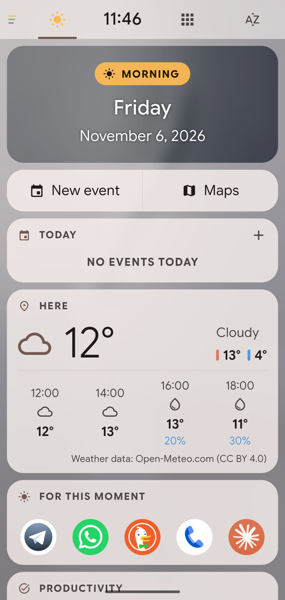
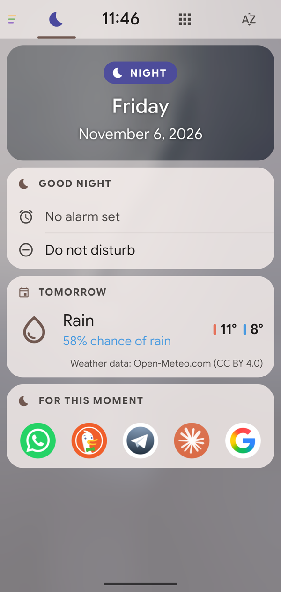

# libreGLIDE

<p align="center">
  
  &nbsp;
  
</p>

A **context-aware**, open source, **local-only** Android launcher, built with Flutter and a thin native Kotlin layer. The home changes with the time of day, your places (home, work, travelling), the car and your music, and it learns from your habits. Everything stays on the phone.

> Version **1.1.0**. Tested on a Pixel 7 with Android 17; works on Android 12 and later.

## Features

- **Four pages**, swiped horizontally: **Space ← Home → Collections → A-Z**. The Home button always brings you back Home.
- **Space:** the page for the moment. The date card shows the current Space: Wake up, Morning, Lunch, Afternoon, Evening, Night, Home, Work/School, On the move, Listening or Travelling. Each Space has its own content:
  - **Quick actions:** alarm, new event, maps, timer, places to eat, tomorrow's alarm, and more.
  - **Cards first:** agenda in the morning, tomorrow's weather in the evening, a screen time recap at night.
  - **A row of apps from a category:** news when you wake up, food at lunch, video in the evening.
  - **Other cards:** Agenda, Next destination, Now playing, In the car, Where I parked, Travel, Weather, Good night, Screen time, Android widgets.

  The Space also **learns from how you use it**. Cards you tap often in a context move up, and they show up even where the profile didn't plan them. Long-press a card to "Always show" or "Hide" it in that Space, or open **Settings → Space → Cards per Space** to choose Automatic, Always or Never for every card in every Space. The side drawer lets you pick a Space by hand.
- **Home:** the wallpaper framed by the tab bar and the dock, up to 3 full-width Android widgets, and a 4-slot dock. Long-press and drag an app to reorder the dock. The dock can be a solid tray or transparent, and the frame's rounded corners can be turned off.
- **Collections:** one card per category with the apps most likely *right now*, expandable. Cards can be pinned or hidden.
- **A-Z:** grid or list, accent-insensitive search, letter rail.
- **Global search** (swipe up): 4 or 8 suggested apps, and a single match opens on its own. **Contacts** (swipe down): a tap opens the dialer with the number; a long press offers call, message and contact card. Both gestures can be changed.
- **On-device prediction:** Naive Bayes with counters that decay over time (30-day habit, 6-hour momentum). Its signals are time slot, type of day, network, audio output, place and motion.
  - With usage access, it also learns from apps opened outside libreGLIDE (notifications, recents, links), starting from the last two weeks. This can be turned off.
  - A diagnostics screen explains every choice.
- **Places without typing names:** home and work are recognized automatically from sleep, weekday stays and hashed Wi-Fi, and they can be corrected.
- **Digital detox:** locks the apps you choose, all day or during a time range.
  - A PIN of 8 to 16 characters, stored only as a hash.
  - Unlock with the PIN, or never.
  - An option to hide locked apps.
  - A plain black lock screen.

  It uses an accessibility service that receives **only** the name of the app in the foreground.
- **Material You look:** system colors or 8 presets, 5 palette styles, contrast levels, light/dark/automatic theme, themed icons, the system font (Google Sans Flex where available), and an optional **frosted glass** mode with Android's system blur.
- **Contextual wallpaper** from Unsplash (optional, with your own key), chosen by moment and weather, shown only inside libreGLIDE.
- **Languages:** English, Italian, Spanish, German and French. The privacy policy is available in English and Italian.

## Privacy

Full policy: [docs/PRIVACY.md](docs/PRIVACY.md). It is also shown in the app, during onboarding and in Settings → About.

- No accounts, no ads, no telemetry.
- **Optional network use:** only the Unsplash wallpaper (with a key you enter) and the Weather card (Open-Meteo, with a rounded location). All network code lives in `lib/net/`.
- **Permissions:** every permission is optional and is requested by the feature that needs it. Background location is used only by "Where I parked", which is off by default.
- **Storage:** launch history is kept in SQLite, deleted after 180 days and excluded from cloud backup.
- **Deleting data:** everything can be wiped from the settings.

## Install

Download the APK from the latest [release](https://github.com/federicocandiago/libreglide/releases), open libreGLIDE and set it as your Home app. It requires Android 12 or later on a 64-bit (arm64) phone.

## Build

You need Flutter 3.47+, JDK 17 and the Android SDK with platform 37 (Android 17). `minSdk` is 31.

```sh
flutter pub get
flutter test
flutter build apk --release --target-platform android-arm64
```

Without `android/key.properties`, the release build is signed with the debug key.

Developer commands open a screen without touching the phone:

```sh
adb shell am start -n org.libreglide.launcher/.MainActivity --es open settings
```

## Project layout

```
lib/
  core/        pure Dart logic, testable without a device
               (context, prediction, Collections, places, Spaces, search, detox…)
  data/        settings (shared_preferences) and history (SQLite)
  net/         the only network code (Unsplash, Open-Meteo)
  platform/    Dart side of the Kotlin bridge
  state/       controllers (apps, cards, places, weather, wallpaper)
  theme/       Material You palette and system font
  ui/          pages and widgets (Glide style in ui/glide_style.dart)
  legal/       privacy policy
  l10n/        translations (ARB)
android/app/src/main/kotlin/org/libreglide/launcher/
  MainActivity.kt, LibreGlideApplication.kt   Home activity and always-warm engine
  LauncherBridge.kt                            apps, icons, permissions, context, widgets
  Detox*.kt                                    Digital detox (service and lock screen)
  WindowGlass.kt                               frosted glass (system blur)
  ParkingReceiver.kt, MediaWatcher.kt          parking and music
test/core/                                     core tests
docs/                                          specs (in Italian), privacy policy, screenshots
```

## License

[GNU General Public License v3.0](LICENSE) or later.

Weather data by [Open-Meteo.com](https://open-meteo.com) (CC BY 4.0). Photos from [Unsplash](https://unsplash.com), with the author credit shown in the app. Library licenses are listed in Settings → About → Open source licenses.
